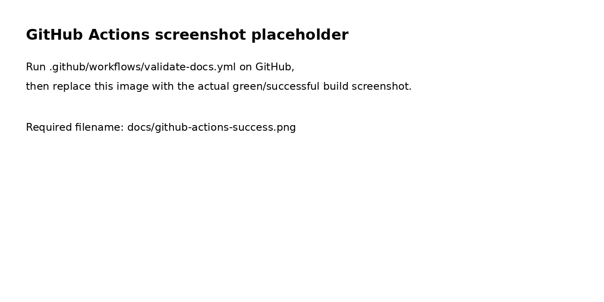

# RaceDay — Part 2 RESTful API

RaceDay is an event-management API for race organisers and participants. This repository continues the Part 1 ERD, endpoint plan and SQL Server schema. The API uses ASP.NET Core Web API, Entity Framework Core Code First, SQL Server, server-side session authentication, role-based authorization, Swagger, unit tests and GitHub Actions.

## Roles

- **Organiser:** create/update/delete events they manage, maintain event categories, view enrolments for their events, and create/update results.
- **Participant:** view events and categories, manage their own profile, enrol in categories, cancel their own enrolments, and view their own results.
- **Public:** register/login and browse events/categories.

## Repository layout

- `docs/` — Part 1 ERD, SQL script, endpoint plan and DBML.
- `src/RaceDay.Api/` — ASP.NET Core API.
- `tests/RaceDay.Api.Tests/` — unit tests.
- `.github/workflows/` — Part 1 documentation validation and Part 2 build/test CI.

## Requirements

- .NET 8 SDK
- SQL Server or SQL Server LocalDB
- Visual Studio 2022 (ASP.NET and web development workload) or VS Code
- SQL Server Management Studio (SSMS), recommended

## Database setup

1. Open SSMS and connect to your SQL Server.
2. Run `docs/raceday.sql` to create and seed the `RaceDay` database.
3. The Part 1 seed passwords are placeholders, not usable login credentials. For Part 2 testing, register users through `/api/auth/register` with your own test passwords. Do not expose real passwords in source control.
4. If you use a server other than LocalDB, update `ConnectionStrings:RaceDay` in `src/RaceDay.Api/appsettings.json` or set the `ConnectionStrings__RaceDay` environment variable.

> Warning: `docs/raceday.sql` drops an existing `RaceDay` database before recreating it. Back up any data before running it.

## Run the API

From the repository root:

```bash
dotnet restore RaceDay.sln
dotnet build RaceDay.sln
dotnet run --project src/RaceDay.Api/RaceDay.Api.csproj
```

Open the Swagger URL shown in the console (normally `https://localhost:7194/swagger`).

### Authentication in Swagger

1. Call `POST /api/auth/register` with `fullName`, `email`, `password` (minimum 8 characters), and `role` (`Organiser` or `Participant`).
2. Or call `POST /api/auth/login` with `email` and `password`.
3. The API establishes an HTTP-only `.RaceDay.Session` cookie. Keep using the same browser/session when testing protected endpoints.
4. Call `POST /api/auth/logout` to clear the session.

The session is server-side, and the API never returns or stores the original password. For production deployment, configure HTTPS, a persistent/distributed session store, secure cookie settings, CSRF protections for cookie-authenticated state-changing requests, rate limiting, and a secrets manager.

## Run unit tests

```bash
dotnet test RaceDay.sln
```

The test project checks password hashing, the model's core relationships and the accepted role allowlist. The CI workflow restores, builds and runs the test suite on each push and pull request.

## Endpoint specification

See [`docs/api-endpoints.md`](docs/api-endpoints.md). This is aligned to the endpoint list in the supplied Part 1 PDF.

## GitHub Actions

The workflow at `.github/workflows/raceday-api-ci.yml` runs restore, build and tests. The existing Part 1 workflow is retained. After pushing the repository, open **GitHub → Actions**, confirm the latest run is green, and add a genuine screenshot below.

### Successful CI screenshot

Replace `docs/github-actions-success.png` with your actual green workflow screenshot before submission.



## Video presentation

Add your actual unlisted YouTube link after recording:

`PASTE-YOUR-UNLISTED-YOUTUBE-LINK-HERE`

The video should demonstrate Swagger, registration/login, the two roles, event/category management, enrolment, results, the database schema and unit tests.

## Important submission notes

- Make at least 20 meaningful commits using your own GitHub account; do not fabricate history.
- Run the solution locally and fix any environment-specific issues before submission.
- A screenshot and YouTube URL must be real artifacts from your own run; placeholders are not proof of a successful build.
